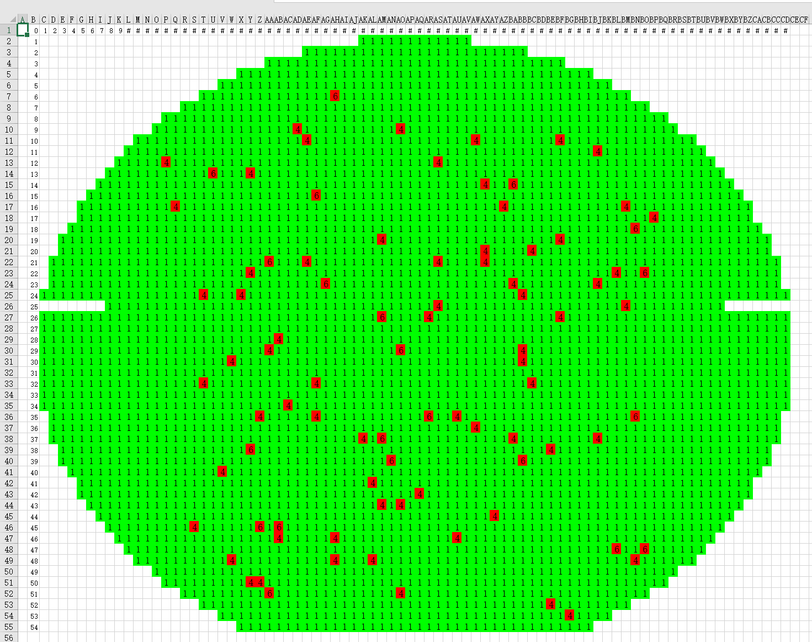
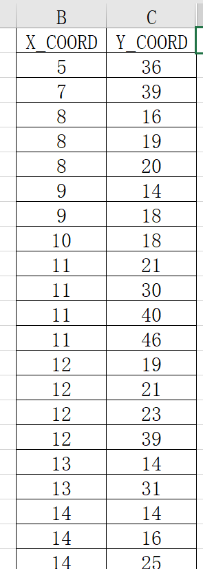
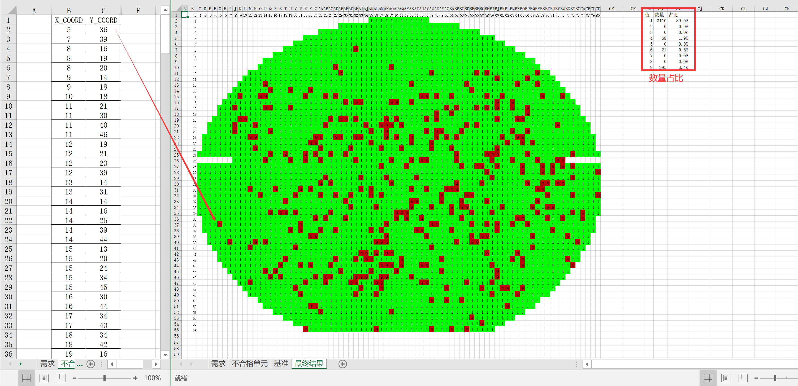
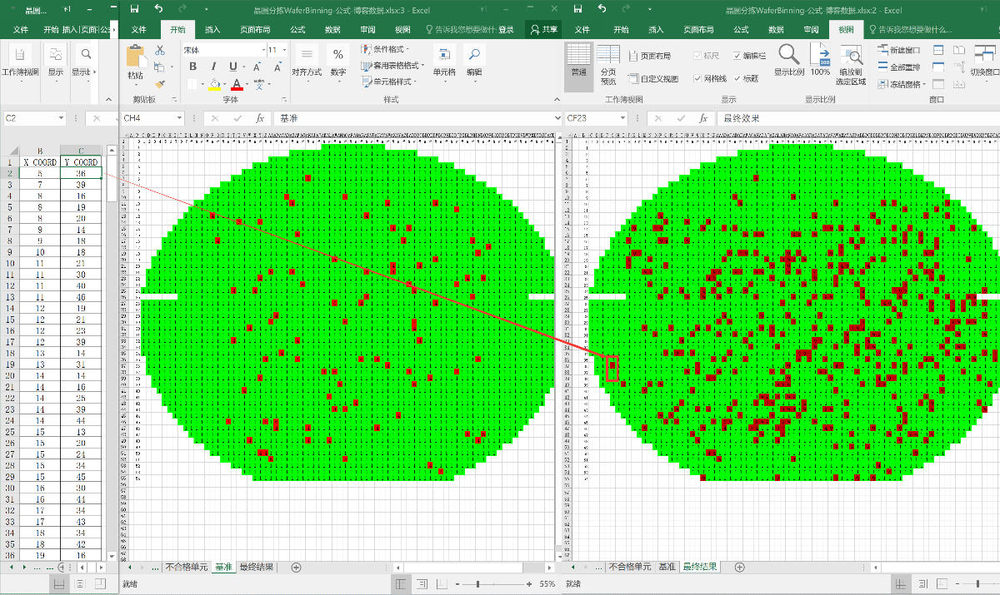

+++
date = '2026-10-14T10:38:27+08:00'
draft = false
title = '标记晶圆上不合格晶粒'
+++
Excel表格里面有两张sheet页，“基准”和“不合格单元”

“基准”sheet页里面有1块晶圆形状的示意图，有的单元格等于1，有的单元格不等于1。

“不合格单元”sheet页里面，标记了不合格单元格的横纵坐标

需求是这样的：

1、“基准”sheet页里面不等于1的单元格保持不变，等于1的单元格，按照坐标在“不合格单元”sheet中查找，如果找到，用9填充单元格的值，结果放在新的“最终结果”sheet页面

2、统计晶圆上占比每一个标记值的数量

3、查找结果根据数据实时变化

“基准”sheet页：

“不合格单元”sheet页：

最终结果，改变xy坐标，最终结果跟随数据变化，右上角统计每一标记的数量和占比：

动态效果如下图，左侧是不合格晶粒的坐标，中间是基准，右侧是基于基准标记不合格晶粒之后的结果图，当左侧不合格晶粒的坐标变化时，标记图会随之变化：
